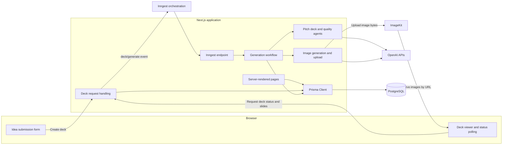
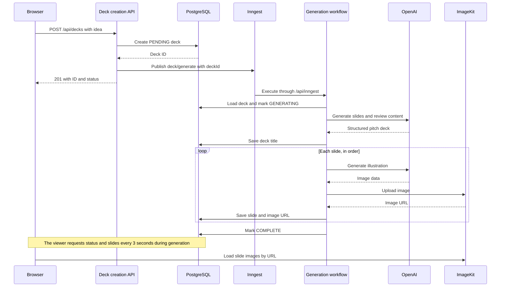
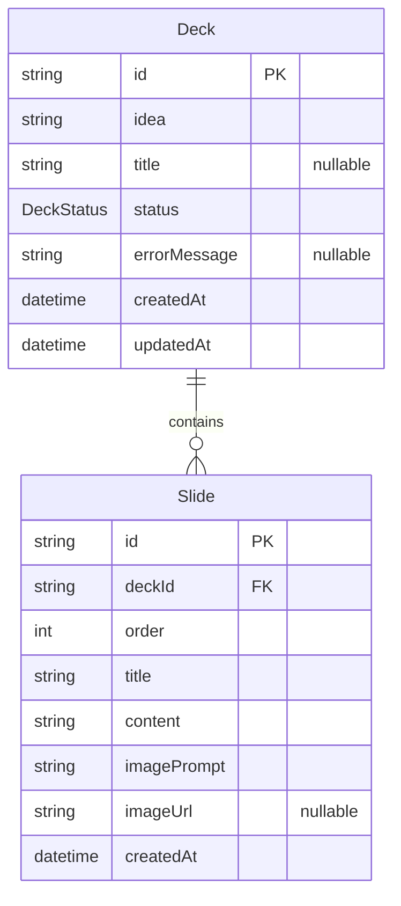

# Architecture

AI Pitch Deck combines a Next.js web interface, server-side request handling, and an event-driven generation workflow. PostgreSQL stores presentation data, OpenAI generates content and illustrations, and ImageKit hosts slide images.

Frontend and backend code live in the same application. Inngest coordinates background execution through the application's `/api/inngest` endpoint.

## System Overview

## Frontend Architecture

The interface uses React 19, TypeScript, Tailwind CSS 4, and shared shadcn/ui and Base UI components. Next.js Server Components compose pages and perform server-side reads; Client Components manage interactive state and browser requests.

### Pages and Components

| Module | Execution boundary | Responsibility |
| --- | --- | --- |
| [`app/layout.tsx`](app/layout.tsx) | Server | Root document, global styles, and fonts. |
| [`app/page.tsx`](app/page.tsx) | Server | Home page and idea submission layout. |
| [`app/decks/page.tsx`](app/decks/page.tsx) | Server | Queries Prisma directly and renders the deck library, newest first. |
| [`app/decks/[id]/page.tsx`](app/decks/[id]/page.tsx) | Server | Resolves the deck ID and composes the detail page. |
| [`components/create-deck-form.tsx`](components/create-deck-form.tsx) | Client | Idea input, minimum-length validation, submission state, and navigation. |
| [`components/deck-viewer.tsx`](components/deck-viewer.tsx) | Client | Fetching, status polling, loading and error states, and slide navigation. |
| [`components/deck-status-badge.tsx`](components/deck-status-badge.tsx) | Shared presentation | Maps persisted status values to labels and badge styles. |
| [`components/ui/`](components/ui/) | Component-dependent | Shared buttons, cards, carousel, progress indicators, and other interface primitives. |

### Browser Data Flow

The submission form sends `{ idea }` to `POST /api/decks`. After receiving the new deck ID, it navigates to `/decks/{id}`.

The deck viewer requests `/api/decks/{id}` on mount and repeats that request every three seconds while the deck is `PENDING` or `GENERATING`. It displays generation progress using the current status and saved slide count, then renders the slide carousel when the deck is `COMPLETE`. Polling stops when the deck leaves a generating state.

React component state holds form values, fetched deck data, and carousel position. Shared response types are defined in [`lib/types/deck.ts`](lib/types/deck.ts).

## Backend Architecture

The backend consists of request handling, generation orchestration, AI services, image services, and database access.

### Request Handling

| Module | Responsibility |
| --- | --- |
| [`app/api/decks/route.ts`](app/api/decks/route.ts) | Exposes `GET` for deck summaries and `POST` for deck creation and event publishing. |
| [`app/api/decks/[id]/routes.ts`](app/api/decks/[id]/routes.ts) | Contains the deck detail lookup implementation, including slides ordered by their `order` field. |
| [`app/api/inngest/route.ts`](app/api/inngest/route.ts) | Exposes the Inngest integration through `GET`, `POST`, and `PUT`. |
| [`lib/db.ts`](lib/db.ts) | Creates the Prisma Client with the PostgreSQL driver adapter. |

Deck creation trims and validates the idea using Zod. Invalid JSON or an idea shorter than 20 characters receives a `400` response. A valid request creates a `PENDING` database record, publishes `deck/generate` with `{ deckId }`, and returns the ID and status with a `201` response.

The deck library page reads PostgreSQL directly through Prisma. Browser interactions use HTTP requests to exchange JSON with the backend.

### Background Workflow

[`inngest/client.ts`](inngest/client.ts) defines the Inngest client. [`inngest/functions/generate-deck.ts`](inngest/functions/generate-deck.ts) registers the `generate-deck` function for `deck/generate` events.

| Step | Work performed |
| --- | --- |
| `load-deck` | Load the deck using the event's `deckId`. |
| `mark-generating` | Set the deck status to `GENERATING`. |
| `run-agent` | Generate structured slide content and apply AI guardrails. |
| `save-title` | Persist the generated presentation title. |
| `image-{order}` | Generate a slide image and upload it to ImageKit. |
| `save-slide-{order}` | Save the slide text, image prompt, image URL, and position. |
| `mark-complete` | Set the deck status to `COMPLETE`. |
| `mark-failed` | Store a failure status and error message for errors caught during generation. |

Slides are processed sequentially. Each image upload finishes before its slide is saved, and the workflow completes after all slides have been persisted. Named steps let Inngest track workflow progress and coordinate execution across requests.

Guardrail failures are converted to non-retriable errors. Other errors caught by the workflow are recorded and rethrown for Inngest retry handling.

### AI and Image Services

| Module | Responsibility |
| --- | --- |
| [`lib/agents/pitch-deck-agent.ts`](lib/agents/pitch-deck-agent.ts) | Configures `gpt-4.1-mini` to write an investor-focused pitch deck with slide illustration prompts. |
| [`lib/agents/guardrails.ts`](lib/agents/guardrails.ts) | Enforces minimum idea length and uses a second agent to review generated content. |
| [`lib/agents/generate-pitch-deck.ts`](lib/agents/generate-pitch-deck.ts) | Runs the agent, parses its output, and translates guardrail failures into application errors. |
| [`lib/schemas/pitch-deck.ts`](lib/schemas/pitch-deck.ts) | Defines Zod constraints for deck titles, slide text, image prompts, and slide counts. |
| [`lib/openai.ts`](lib/openai.ts) | Generates 1024 × 1024 images with `gpt-image-1-mini` and decodes image data into buffers. |
| [`lib/imageKit.ts`](lib/imageKit.ts) | Uploads image buffers into `/pitch-decks` and returns hosted URLs. |

The writing agent targets six to seven slides, while the schema accepts five to eight. Content review checks for unsuitable content, placeholder text, meaningless filler, and output unrelated to a business pitch.

When `USE_PLACEHOLDER_IMAGES=true`, the image service retrieves stock images from Picsum. Slide writing, quality review, and ImageKit uploads follow the same workflow.

## Generation Sequence

## Data Architecture

[`prisma/schema.prisma`](prisma/schema.prisma) defines a one-to-many relationship between decks and slides.

Deck and slide IDs use CUIDs. Slides have an index on `deckId`, and deleting a deck cascades to its slide records. The `order` field determines presentation order. PostgreSQL stores image URLs and prompts; image files are stored in ImageKit.

The normal status progression is `PENDING → GENERATING → COMPLETE`. Caught generation failures are recorded as `FAILED`, with an error message available to the viewer.

## Deployment Boundaries

| Runtime or service | Responsibility | Configuration |
| --- | --- | --- |
| Browser | Form interaction, status requests, slide navigation, and image display. | Receives rendered UI, JSON responses, and image URLs. |
| Next.js server | Server Components, request handlers, workflow execution, and service clients. | Server-side environment variables. |
| Inngest | Event delivery, workflow coordination, step tracking, and retry handling. | `INNGEST_EVENT_KEY`, `INNGEST_SIGNING_KEY`, deployed `/api/inngest` endpoint. |
| PostgreSQL | Deck metadata, status, and ordered slide records. | `DATABASE_URL`. |
| OpenAI | Slide writing, quality review, and illustration generation. | `OPENAI_API_KEY`. |
| ImageKit | Image storage and delivery. | `IMAGEKIT_PRIVATE_KEY` for server-side uploads. |

Prisma configuration lives in [`prisma7.config.ts`](prisma7.config.ts), migrations live in [`prisma/migrations/`](prisma/migrations/), and the generated client lives in `lib/generated/prisma`. Client generation runs before the application build, and committed migrations are applied during release.

See [README.md](README.md) for environment setup, development commands, and deployment instructions.
